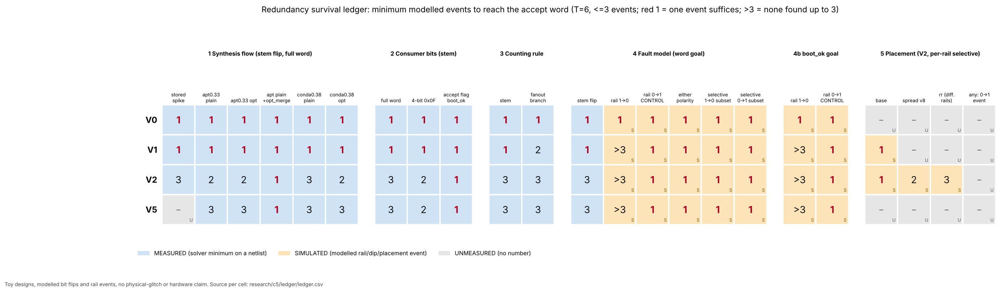
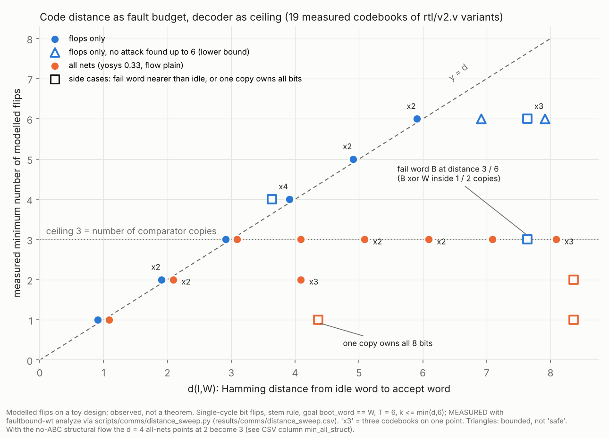

# Project (working title TBD)


## What this is (plain words; same text as the explainer, `docs/wow/explainer.html`)
- **Built:** a computer check that finds the fewest modelled glitches (bit flips) that fool a toy lock design with redundant guard copies.
- **Found:** how many it takes depends on exactly how the lock is wired, how it is built by synthesis, and how you count (1, 2 or 3 flips for the same design).
- **Not done:** nothing physical was tested; no novelty claim. Open `docs/wow/explainer.html` first (5 minutes, no jargon).

## Try it (open in a browser; offline, no install; toy designs, modelled flips only)
- [Verdict Dial](docs/wow/dial.html): flip four switches and watch one measured number go 3 -> 2 -> 1 -> 0; predict first, every digit cites its source row.
- [Solver Replay](docs/wow/theatre.html): the solver's own witnesses replayed in gate-level simulation; V1 opens with one flipped wire, V2 needs three (`?kiosk=1` loops).
- [264 builders](docs/wow/wall.html): one blueprint, 264 synthesis settings, 152 distinct netlists, minimum flips 1, 2 or 3 per tile (`?kiosk=1` loops).
- [Explainer](docs/wow/explainer.html) and [game](docs/wow/game.html): five minutes, no jargon.
- [Dashboard](dashboard/index.html): every measured run, with a Scope tab.
- [Coding view](docs/comms/CODING_VIEW.md): the same results read as codes (distance, waterfall, bursts, decoders). Stage script: `docs/DEMO_3MIN.md`.

## The problem (working statement P3; owner decides wording: `docs/dossier/PROBLEM_STATEMENT_EVOLUTION.md`)
Given a gate-level netlist and the bits a consumer actually checks, report how many single-cycle flips defeat a redundant boot decision, which nets the supposed copies share, and how that answer changes with synthesis build, counting rule and scope.

## One glance (MEASURED; modelled single-cycle bit flips, 6 cycles, k <= 3, toy 8-bit designs; nothing physical)
Minimum flips the solver needs to make V2 (triplicated check) accept a wrong input. V1 is duplicated, V0 naive.

| Goal / consumer (V2) | Flips | Source |
|---|---|---|
| Full 8-bit word, stored netlist | **3** | `research/c2/b2_scope/B2_REPORT.md`, `research/c3/m1/M1_REPORT.md` |
| Full 8-bit word, `rtl/v2.v` re-synthesized with apt Yosys 0.33 (85 gates). Not a version effect: the stored netlist is also Yosys 0.33 (68 gates, another flow). Cause: the armed word 0xCC differs from 0x96 only in bits of 2 of the 3 copies. Over the 8 `--synth-sweep` flows: 2 1 1 2 2 2 2 2; re-encoded `rtl/v2e.v` (0xA5): 3 1 1 3 3 3 3 3; conda 0.38 (83 gates) gives 3 on the plain flow and 2 on three other flows. Encoding sets the floor (idle word touches 2 of 3 copies => 2 flips); the synthesis flow decides whether the floor is reached (1 when a flow merges the copies). A build or flow difference changes the netlist, not the underlying weakness. | **2** | `docs/report/WHY_TWO_FLIPS.md`, `research/c6/p01/P01_REPORT.md` |
| Consumer that checks only 4 bits (stored netlist) | 1 to 3 (28 / 36 / 4 of 68 masks need 1 / 2 / 3); M1 figures: rechecked by M1b with two engines: no cell changed (0 of 1785; research/c4/m1b/M1B_REPORT.md) | `research/c3/m1/m1_all_masks.csv` |
| Accept flag `boot_ok`; or input nets as fault sites; or arbitrary non-accepting power-up | **1** | B2 matrix (360 cells) |
| V1 and V0, every known-power-up scope cell tried (0 with arbitrary power-up: no reset modelled) | **1** (V1 needs 2 in 31 of 264 re-synthesis configs) | B2, E2 |
| V2 over 264 solved synthesis configurations | 1 in 180, 2 in 60, 3 in 24 (of 264 solved configs; 152 distinct netlists: 94/38/20) | `research/c2/e2_variance/E2_REPORT.md` |
| Rail-dip events, a negative-control row (SIMULATED basis, bound T=6, 3 events; toy designs, no extraction) | In our model a 1->0 rail event does not break V1, V2 or V5 within the bound, but a 0->1 event on the three compare copies breaks V2 and V5 with one event: survival depends on polarity, not on triplication. The domain is the netlist hierarchy, not a physical rail; the physical track is closed (no extraction; selectivity unproven; spread layouts failed LVS 4/4). Details and sources: `research/c5/ledger/LEDGER.md`, `docs/report/PROJECT_REPORT.md`. | `research/c4/b3/B3_REPORT.md`, `research/c5/ledger/LEDGER_REPORT.md`, `research/c5/anchor/RAIL_RECONCILIATION.md`, `research/c4/layout/LAYOUT_REPORT.md` |

So: copies that share one wire do not help (V1 breaks with one flip on `ok`), and "V2 resists 2 flips" is true only in one narrow cell (full word, input nets not fault sites, known power-up, stored netlist). Never quote it without those qualifiers. All numbers come from one solver on small toy designs written by agents, under modelled fault rules that are not shown to be physical.

Redundancy-survival ledger (every cell labelled MEASURED / SIMULATED / UNMEASURED; `research/c5/ledger/LEDGER.md`). V1 and V2 tie in every rail-event ledger row and differ only in the stem-flip and fanout-count rows (table 'What triplication bought', `docs/report/PROJECT_REPORT.md`); triplication buys one extra gate under a selective event (2 vs 3 gates).



**Redundancy is a code** (MEASURED, `results/comms/distance_sweep.csv`, `research/c6/p11/P11_REPORT.md`; toy design, modelled flips, observed not a theorem, nothing new). The state words F0, CC, 96, 69 are codewords of the textbook Reed-Muller code RM(1,3) (distance 4), and the copies are a repetition code. Over 19 codebooks: with only the state flops as fault sites the minimum equals the distance to the nearest non-accept word in 15 of 15 codebooks with distance <= 6; with all nets it never exceeds that (19 of 19), and it stays at about one flip per comparator copy. Failed predictions, kept: (a) 'flops-only = idle-to-accept distance' fails where a fail word is nearer; (c) 3 of 16 three-copy codebooks sit at 2, not 3, on the project flow; word order matters under ABC (F0 then CC gives 2, CC then F0 gives 3); the mechanism was not dissected. More: `docs/comms/CODING_VIEW.md`, `docs/report/WHY_TWO_FLIPS.md`.




## Status and cautions

**Safety status:** RT2 (`research/c5/rt2/RT2_REPORT.md`) found a HIGH command-execution bug (the module name or Verilog path was pasted into a Yosys command). Agents H2 and H3 fixed it in the product, `scripts/synth.sh` and `glitchsat.py check`; the lead re-tested it with a canary file on 2026-11-19 22:42 UTC (rejected, exit 3, no file created). The GitHub Action's two shell steps were run locally in a clean venv (MEASURED by the lead, 2026-11-20; the `uses:` steps and the SARIF upload cannot run off GitHub, so nothing ran on GitHub), and the Dockerfile was built and run locally only after adding the sandbox proxy's CA to a COPY of it (shipped Dockerfile unchanged; not built on a normal network). Until a human has reviewed the fix, still do not run the Verilog path or the Action on untrusted input. Other RT2 findings: `docs/dossier/CRITIQUE.md` (RT2-N1 to N14).

## Which numbers rest on what (MEASURED; sources in `docs/FINAL_STATUS.md`)
- **Independent anchor:** the 36 reproduce rows (second simulator, `validation/VALIDATION.md`); M1's 255 consumer masks (brute force, T=4, k<=2, 255 of 255 agree).
- **z3 alone, no second engine:** the B3 rail-dip rows at T=6 with k=3 events, and every V5 row. Brute-force anchors now exist (agent ANCHOR, z3-free simulator, `research/c5/anchor/`): V2 spike stem flips (k<=2 none at T=4; 182 attacking triples at k=3), V2 apt pairs (3 attacking pairs at k=2), B3 rail models (32 rows, T=4, k<=2, all agree with z3) and selective sets (22 sets of size 3, none of size 1 or 2). Still z3-only: T=6 rail events at k=3, and V5.

## Counting rule
Headline rule: a flip of a net (stem) is one fault, however many gates read it (matches FIRMER's per-gate counting; `research/c3/r22/R22_REPORT.md`). Counting a fanout-f net as f faults is a stress test. Neither rule is shown physical. Under stem = 1, V2 holds against 2 flips on 6 of 32 re-synthesized netlists; under fanout counting on 32 of 32. Measured by agent DA, replicated by agent REP on 64 of 64 rows with one reused recipe list (one recipe, not independent designs; `research/c3/rep/REP_REPORT.md`). 6/32 (REP, one recipe family) and E2's 180/60/24 are counts in different grids, not comparable rates (ANCHOR N5: on 24 REP/E2 netlist pairs the minimum flips agree 24 of 24).

## What this is, and what it is not
- A reproducible fault-injection analysis toolkit (solver, dashboard, flow-demo layouts, a small CLI in `product/`) and a specimen showing how a redundancy verdict moves with scope, consumer width, synthesis and counting rule.
- **Synthesis dependence is not new:** Previously shown by SYNFI (arXiv 2205.04775, SOURCED): faults needed dropped 3->2 after Yosys FSM recoding and 4->2 after register merging; `set_dont_touch` restored 4. Our E2 replicates the effect on a toy design across 864 synthesis configs and adds a keep-attribute axis (`(* keep *)` changed no verdict). Counting conventions of other tools: `docs/report/COUNTING_CONVENTIONS.md`.
- **No novelty claim**: nothing established as new. Prior art: SYNFI, FIRMER, k-FRP, CLEAVE, FIVER, uArchiFI (`docs/PRIOR_ART.md`; k-FRP and FIVER full texts unread). Third-party tools: uArchiFI run on 9 of 9 cells, same minimum flips as ours (one tool, three toy designs; not a validation; counting unit matters); k-FRP built but answers a different question; FIVER not built or run (RUN2, measured). Derived code stays local in `third_party_derived/`, never in a bundle.
- Model only: no chip, hardware, physical glitch, fabrication, sign-off or deployed-product finding.
- **Not proven:** that any design is secure (bounds are 6 cycles, k <= 3; `>3` is not "secure"); the one unbounded proof (ABC PDR, V2 spike, k <= 2) is one netlist and not replicated; no counting rule is physical; whether a real supply dip can choose which gates fall; the predictor (below) is not validated.
- **Consumer-mask rule:** The consumer-mask rule is the minimum of Hamming distance to idle states and the number of comparator copies touched: known-style cut/Hamming reasoning, not a discovery; exact on spike V2 (255/255), 187/255 on apt (DA3).
- Structural predictor (`research/c4/pre/`, research script): exact on 150 of 163 fresh toy cells (92%), against 62% for always predicting 1 and 83% for the sound lower bound alone; LEDGER: 71 of 71 on a stratified sample of the same E2 family, 4 of 6 on fresh RTLs (wrong on the voter designs V2m and V5); 58% on cells needing 2+ flips; 1.4x slower than the solver. A heuristic with a sound lower bound; the solver stays the reference. The old 928/928 is near-duplicate cells. DA3's 155 is unreconciled and was not reproduced: a recount of `research/c4/ver/heldout.csv` gives 144 (raw string match and the `est` column), 148 for the `pred` column with '>3' read as 4, 150 after the two x-init corrections (NUMBERS.md); 150 stands.

## Shipped tool vs research (status)
- In `product/`: consumer bits, goal output, input sites, power-up modes, scope sweep, width sweep, timeout (PS4, PS5). **Not shipped:** branch counting rule, per-cycle attacker input (TODO `config.py`), predictor.
- Layout (`layout/`) needs a separate EDA install; not in CI. Dockerfile built and run locally only (sandbox-CA copy, not on a normal network); GitHub Action's shell steps run locally only (not on GitHub: `actions/setup-python` and the SARIF upload untested). A dependency-confusion bug in the Action's default `package-path` was found and fixed by running it.
- Open: layout-based selectivity study (L2 done: spread layouts raise the radius to 11 to 18 um but a die-wide selective dip still costs 1 and LVS fails 4 of 4; `research/c4/l2/`); faster at-most-k encoding applied by T3 (`--amk counter`, default; `research/c4/t3/`).
- **Product safety:** RT2 (`research/c5/rt2/RT2_REPORT.md`, MEASURED) found a HIGH command-execution bug (the top name or Verilog path was pasted into a Yosys command). H2 and H3 fixed it in the product, `scripts/synth.sh` and `glitchsat.py check`; the lead re-tested it with a canary file on 2026-11-19 22:42 UTC (rejected, exit 3, no file created; MEASURED). The GitHub Action's two shell steps were run locally in a clean venv (MEASURED by the lead, 2026-11-20; the `uses:` steps and the SARIF upload cannot run off GitHub, so nothing ran on GitHub), and the Dockerfile was built and run locally only after adding the sandbox proxy's CA to a COPY of it (shipped Dockerfile unchanged; not built on a normal network). Yosys itself is not sandboxed. Until a human has reviewed the fix, still do not run the Verilog path or the Action on untrusted input. Other findings: `docs/dossier/CRITIQUE.md` (RT2-N1 to RT2-N14). `product/README.md` is not edited here.

## Quick start (Linux; verified by agent RA, counts by RECON on a copy, 2026-11-19)
```
sudo apt-get install -y yosys iverilog          # tested with yosys 0.33, iverilog 12.0
python3 -m venv .venv && . .venv/bin/activate
pip install -r ci/requirements-ci.txt           # z3-solver, pytest
make check-tools && make test                   # 189 passed, 2 skipped with `pip install ./product[test]`, no numpy, no browser (quote your own count)
make reproduce && make check-reproduce          # V0/V1/V2 sweeps (~25 s), 36/36 rows
```
`make reproduce` and `make test` rewrite `results/` and `tb/`: run them on a copy. Product tests (`pip install ./product[test]`): 324 passed. Mutation score of the tests (REPORTED, not re-run): root 72.5% (50/69), product 67.6% (50/74). The apt 0.33 and conda 0.38 builds give different V2 netlists (85 vs 83 combinational gates; a build or flow difference changes the netlist, not the underlying weakness, `docs/report/WHY_TWO_FLIPS.md`), so CI on another Yosys may not reproduce `ci/expected_reproduce.json`. `make help` lists targets.

## Where things are
- `START.md` first path; `docs/OWNER_DERIVATION_SHEET.md` pencil derivations; `docs/dossier/` dossier, Q&A sheet, evidence index, critique; `docs/edu/` classroom kit; `docs/wow/` explainer and game.
- `rtl/` designs, `reference/spike_netlists/`, `scripts/glitchsat.py` solver, `formal/`, `results/`, `dashboard/` (now with a Scope tab), `layout/`, `product/`, `research/` reports. Run log: `handoff/CONTINUATION/RUN_LOG.md`.
- Every number carries one label (MEASURED, SIMULATED, ESTIMATED, ILLUSTRATIVE, UNVERIFIED): `docs/EVIDENCE_LABELS.md`. Licence: undecided (`LICENSE_CHOICE.md`).
