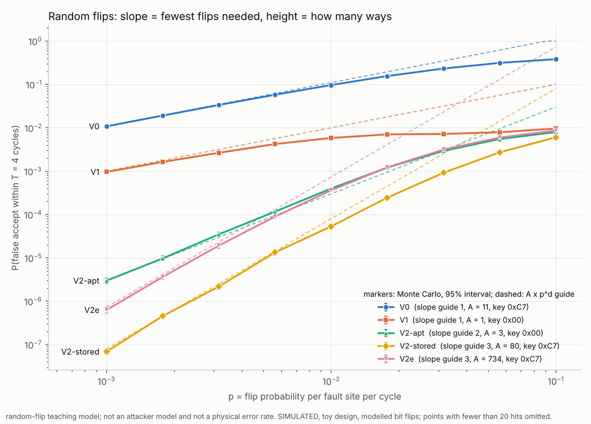

# Waterfall: the same designs under random flips

Random-flip teaching model; not an attacker model and not a physical error rate. Toy design. All numbers SIMULATED (`results/comms/waterfall.csv`, made by `scripts/comms/bsc_channel.py all`). Nothing established as new.

## In plain words
Give every wire and flip-flop in the boot checker a small chance p of being wrong in each clock cycle, independently, like line noise. We feed in one wrong key and ask how often the checker ends up saying "accept" within 4 cycles.

- A design that one flip can fool is fooled at a rate of about p times the number of places where one flip works. Halve p and the rate halves.
- A design that needs three flips at once is fooled about p cubed times the number of working triples. Halve p and the rate falls eight times.

On log-log paper that is a straight line. Its steepness is the fewest flips needed. Its height is how many ways there are.

## What a communications professor sees
- **Slope = diversity order.** Fitted low-p slopes: V0 0.98, V1 0.88, V2-apt 2.14, V2-stored 3.00, V2e 2.97 (minimum flips 1, 1, 2, 3, 3).
- **Intercept = multiplicity** (number of minimum-weight error events, as in a union bound). At the plotted key: V0 11 singles, V1 1 single, V2-apt 3 pairs, V2-stored 80 triples, V2e 734 triples.
- **Why the ranking differs from the adversarial minimum.** An adversary only needs one way in, so V2-stored and V2e tie at 3. Noise finds every way in: V2e has about nine times more triples, so it sits about nine times higher (6.3e-7 against 6.9e-8 at p = 1e-3). V1 and V0 tie at 1 for the adversary but differ eleven-fold here. At high noise the lines bend and meet: at p = 0.1 all three V2 netlists are within a factor 1.6 of V1, and from p = 1.8e-2 V2e is level with or above V2-apt although it needs one more flip.

## Fine print
- T = 4 cycles; sites = every gate output and flop Q; false accept = `boot_word == 0x96` at some cycle below 4.
- One fixed wrong key per design, the one with the most minimum-size sets. V2-stored has 182 triples over any wrong key (`research/c5/anchor/`) but only 6.2 averaged over keys.
- The exact series truncated at 3 flips matched the Monte Carlo only at the lowest p: a failed prediction, see `research/c6/p12/P12_REPORT.md`.
- Says nothing about silicon, real error rates or real attackers.
