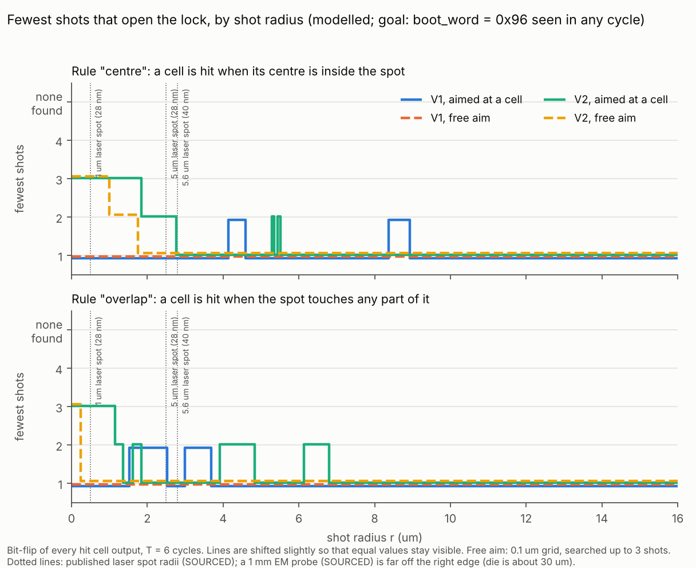
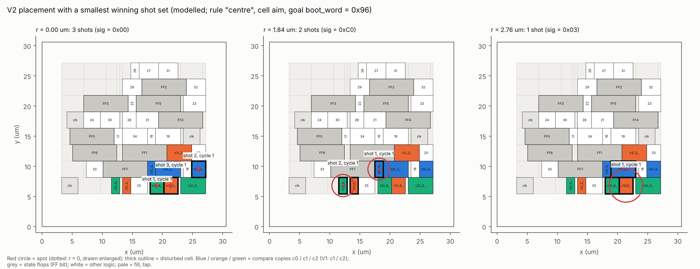

# Glitch shots: a layout-aware fault model for GlitchSAT

## In plain words

A laser pulse or an electromagnetic (EM) pulse does not flip one chosen gate. It disturbs **everything inside a spot**.
Whether a redundant design survives depends on **where its copies sit on the chip**, not just on how many copies it has.

This folder models one "shot" as a disc of radius `r` (in micrometres), fired at one point of the placed chip in one
clock cycle. Every placed logic cell inside the disc is disturbed in that cycle. For the placed sky130 layouts of the
GlitchSAT designs V1 (two compare copies) and V2 (three compare copies), it computes the **smallest number of shots that
makes the lock accept a wrong key**, for every radius.

Main results (modelled, bit-flip, 6 clock cycles, free aim, rule "centre" (ASSUMED: a cell is hit when its centre is in the disc); exact step values below; the overlap rule (ASSUMED) gives fewer shots, see the next paragraph):

| radius r | V1 | V2 |
|---|---|---|
| 0 (one cell per shot, same as the single-flip model) | 1 shot | 3 shots |
| 0.5 um (1 um laser spot, published) | 1 | 3 |
| 1.0 to 1.5 um | 1 | 2 |
| from 1.75 um (sampled; includes the 5 um and 5.6 um published spots) | 1 | 1 |

With the rule "overlap" (ASSUMED, the most pessimistic rule: any touch of a cell's box is a certain upset), **one
shot of radius 0.25 um opens V2**: two compare copies (`c0/_2_`, `c2/_2_`) share the corner (23.00, 8.16) and the third
(`c1/_4_`) is 0.46 um away, across one tap cell; a 0.5 um-diameter disc at about (22.75, 7.93) touches exactly these
three logic cells. Under the overlap rule (ASSUMED), the triple redundancy of V2 gives no protection against a
published laser spot size because the three copies are neighbours. Under the rule "centre" at the published 0.5 um
radius, V2 still needs 3 shots (table above). Placements that pin the copies apart (V2 variants v8, s8, v15, rr) need a
radius of 6.5 to 9 um for a single shot (rule centre, free aim).

**Limits:** these are modelled faults on a placement only. Nothing here was measured or validated on hardware.

Labels (shared with `tools/surface`, `tools/unbounded`, `tools/vlab`): **MEASURED** = tool output on the cloud VM (Ubuntu
24.04), e.g. geometry read from the DEF; **SIMULATED** = output of this physical-fault model (every shot count here);
**SOURCED** / **ASSUMED** = inputs taken from a cited source / chosen by us.

V2e is not placed anywhere in the GlitchSAT repository (no DEF), so it is not analysed (`shotmodel/paths.py`, `UNPLACED`).

**Which netlist "V2" means.** "V1"/"V2" here are the placed-and-routed netlists `layout/v_designs/out_patched/v{1,2}_pnr.v`
with their DEF. They are not the reference Yosys netlists `reference/spike_netlists/v{1,2}.json` used by `tools/surface`
and `tools/unbounded`: at r = 0 the placed V2 has **22** minimum single-cell flip triples (all in cycle 1), the reference
V2 has 182 (`tools/surface`). Both need 3 flips; the counts are not comparable.

## Files

| path | what |
|---|---|
| `shotmodel/design.py` | reads DEF + LEF + post-route netlist, joins them **by instance name** with an exact check |
| `shotmodel/cells.py`, `switchlevel.py` | cell functions; each checked against the PDK transistor netlists |
| `shotmodel/equiv.py`, `rtlref.py` | exhaustive equivalence of each placed netlist with the RTL |
| `shotmodel/shots.py` | geometry: which cells one shot of radius r disturbs |
| `shotmodel/sim.py`, `search.py` | cycle simulation and exhaustive bounded search for the fewest shots |
| `shotmodel/bruteforce.py` | plain reference enumerator (used to check the search and the r = 0 case) |
| `shotmodel/flopspace.py` | reduces a winning shot set to flop flips (shared schema) and re-checks it |
| `shotmodel/literature.py` | spot sizes from the sources below, labelled SOURCED / ASSUMED |
| `shotmodel/smt.py`, `formal/*.smt2` | SMT-LIB export of a few instances for an external SMT solver (no solver run; see "Landing set") |
| `run_all.py` | full study -> `results/shots_results.json` (about 17 min on 2 cores; `--quick` = V1/V2 only, coarse radii, a smoke run; the JSON records `quick`) |
| `shared.py` | `results/<design>_shared.json` in schema `physical-fault-campaign/1` |
| `tables.py` | `results/TABLES.md` (every number in this README comes from there) |
| `plots.py` | `plots/*.png` |
| `tests/` | pytest (`python3 -m pytest -q`; `SHOTS_SLOW=1` adds a K = 3 enumeration) |

Inputs are read from the GlitchSAT repository (read-only), `layout/v_designs/out_patched/{v1,v2}.def`,
`*_pnr.v`, the sky130 LEF in `research/c4/l2_inputs/lef/`, and for the V2 variants `research/c4/l2_inputs/{def,pnr}/`.
SHA-256 of every input file is stored in the results JSON. The repository is found as `$GLITCHSAT_ROOT`
(`$GLITCHSAT_REPO` is accepted as an older alias), else the checkout this folder sits in (`<repo>/ext/shots`).

**Data and licences.** Cell sizes and cell functions come from the SkyWater sky130 PDK (via open_pdks, Apache-2.0):
the sizes-only LEF `research/c4/l2_inputs/lef/sky130_fd_sc_hd_sizes_only.lef` and the PDK transistor subcircuits
inside `layout/v_designs/out_patched/v2_ref.spice`, both derived files already in the repository (THIRD_PARTY.md marks
the LEF UNVERIFIED). Note for the repository owner: NOTICE.md says the repository does not redistribute the sky130 PDK,
yet these derived files are in the tree. The cited slides are used for facts only (URLs below).

Reproduce:

```
python3 run_all.py            # results/shots_results.json (about 17 min; add --quick for a smoke run)
python3 shared.py             # results/<design>_shared.json
python3 tables.py > results/TABLES.md
python3 plots.py
python3 -m pytest -q
```

## The model

**Placed cell to logic (exact, checked).** The DEF `COMPONENTS` and the post-route Verilog must have exactly the same
instance names with the same cell master; any difference stops the program. Cell functions come from a hand-written
table that is compared, input vector by input vector, with a switch-level evaluation of the transistor netlists of the
PDK (23 combinational cell types, the `dfxtp` flop; 0 mismatches). Each placed netlist is then compared with the RTL
exhaustively: all 256 states x all 256 keys (65,536 transitions) and the boot sequence from 0xF0 for all 256 keys over
8 cycles. All 6 placed designs: 0 mismatches, and only key 0xC3 is accepted.

**Shot.** Aim point (x, y), radius r, clock cycle t.
- rule `centre`: a cell is hit when its centre is within r; rule `overlap`: when the disc touches its box.
- aim `cell`: the aim point is the centre of a logic cell; every radius at which the set of hit cells can change is
  evaluated, so these curves are **exact step functions**. aim `grid` ("free aim"): a 0.1 um grid over the die plus every
  cell centre; radii sampled every 0.25 um up to 6 um, then coarser.
- effect: `flip` (output of each hit cell inverted in that cycle; main results), `set0`, `set1` (the bit-set / bit-reset
  effect reported for lasers, table D).
- Clock buffers are not disturbed (`clk=ignore`); `clk=forbid` removes shots that reach a clock buffer (table D).

**Goal.** Key held at a wrong value, state starts at 0xF0, cycles 0..T-1 (T = 6). `word`: boot_word = 0x96 seen in
some cycle (the goal of GlitchSAT's single-flip model). Also `word_clean` (seen in a cycle without a shot) and `ok`
(boot_ok = 1). Several shots in one cycle disturb the union of their discs.

**Search.** Exhaustive and bounded (no solver): iterative deepening on the number of shots K, shortest paths over the
8-bit state, key values grouped into classes that behave identically. A result `>k` means none with up to k shots
within T cycles under this model; it is not a security proof. Every witness is re-run with an independent simulator.

**r = 0 equals the single-flip model.** At r = 0 each shot hits exactly one cell (checked for both rules, all
designs). The shot search at r = 0 is compared with a plain enumeration of every set of single-cell faults on the same
netlist: all designs, 3 effects, T = 6, K <= 2 (22,156 / 23,437 sets each) and T = 3, K <= 3 for V1 and V2 (193,026 and
210,043 sets). All agree: V1 needs 1 flip, V2 needs 3. The search was also checked against the plain enumerator for
r > 0 in 60 settings (589,656 sets): 60 of 60 agree.

## Radius range: sources

Each source below was opened; the location is given. Spot **diameter** d gives radius d / 2.

| fact | label | source |
|---|---|---|
| backside laser, spot 1 um or 5 um (slide 30); 28 nm flip-flop about 4.3 x 1.2 um (slide 33) | SOURCED | Dutertre et al., *Laser Fault Injection at the CMOS 28 nm Technology Node*, FDTC 2018 slides, https://fdtc.deib.polimi.it/FDTC18/shared/FDTC%202018%20-%20session%201.1.pdf |
| AES-128 at 28 nm, 5 um spot, 10 ns, 0.6-1.0 W (slide 42); bits per faulted byte 1: 19,413, 2: 278, 3: 27, 4: 48, 5: 38, 6: 1 (slide 43) | SOURCED | same |
| so 392 of 19,805 single-byte faults (1.98 %, "about 2 %") hit 2 to 6 bits; the rows sum to 19,805, one less than the 19,806 on slide 42 | SOURCED (arithmetic on slide 43) | same |
| "single-bit and bit-set/reset are still practical fault models" at 28 nm (slide 45) | SOURCED | same |
| 40 nm ASIC, backside Nd:YAG, spot 5.6 x 5.6 um (slide 9); "easier to inject multiple bit faults than single bit faults" (slide 17) | SOURCED | Bartkewitz et al., *Beware of Insufficient Redundancy*, TCHES 2022(3), slides, https://iacr.org/submit/files/slides/2022/tches/ches2022/3_57/slides.pdf |
| EM antenna of a few turns, 1 mm diameter, 130 nm MCU | SOURCED | Moro et al., *Electromagnetic fault injection: towards a fault model on a 32-bit microcontroller*, FDTC 2013, https://arxiv.org/pdf/1402.6421.pdf |
| disturbed region = disc of the spot radius; every cell inside is disturbed with certainty | ASSUMED | (the true affected area depends on energy and on each cell's sensitive area) |
| spot sizes measured at 28 / 40 nm applied unchanged in um to sky130 cells (dfxtp_1 is 7.36 x 2.72 um) | ASSUMED | |
| an EM probe of 1 mm covers the whole 30 um die: EM is the r >= cover-radius end of the curve | ASSUMED | |

The swept radius therefore runs from 0 (single cell) through the published laser spot radii 0.5, 2.5 and 2.8 um
(dotted lines on the plot) up to the radius that covers the whole die (44 um), which stands in for EM.

The "about 2 % multi-bit" figure was measured with a 5 um spot on 28 nm cells that are much smaller than sky130 cells.
In this model a 2.5 um radius almost always reaches several cells, so the model is **more pessimistic** (more multi-cell
hits) than that measurement suggests. Nothing here is calibrated against it.

## Results

All numbers are from `results/TABLES.md` (generated from `results/shots_results.json`).



**Exact steps, shots aimed at a cell centre, goal `word`, bit-flip, T = 6** (radius in um; a value holds from the
first number up to the next):

| design | rule | fewest shots |
|---|---|---|
| V1 | centre | 0-4.14: **1**; 4.14-4.60: 2; 4.60-8.36: 1; 8.36-8.93: 2; from 8.93: 1 |
| V1 | overlap | 0-1.53: **1**; 1.53-2.53: 2; 2.53-2.99: 1; 2.99-3.68: 2; from 3.68: 1 |
| V2 | centre | 0-1.84: **3**; 1.84-2.76: **2**; from 2.76: **1** (except 2 shots in 5.29-5.34 and 5.44-5.52) |
| V2 | overlap | 0-1.15: **3**; 1.15-1.36: 2; 1.36-1.61: 1; 1.61-1.84: 2; 1.84-3.91: 1; 3.91-4.83: 2; 4.83-6.13: 1; 6.13-6.80: 2; from 6.80: 1 |

**Free aim** (sampled radii): V1 needs 1 shot at every radius and both rules. V2, rule centre: 3 shots up to 0.75 um,
2 shots at 1.0-1.5 um, 1 shot from 1.75 um; rule overlap: 1 shot from 0.25 um.

Observations:
- The curve is **not monotone**. A larger spot also disturbs cells the attacker would rather leave alone (for example
  a second copy that then disagrees, or the state flops), so the fewest shots can go up again (V1 1 -> 2 -> 1).
- At the published laser spot radii (0.5, 2.5, 2.8 um), V2's three-copy redundancy is reduced to 2 or 1 shots. At
  2.5 um, one free-aimed shot hits `c0/_2_`, `c0/_3_`, `c1/_4_`, `c2/_4_` together ([plot](plots/layout_v2_r2p5_centre_grid.png)).
- V2 placements with the copies pinned apart need 1 shot only from r = 6.5 (rr), 8.0 (s8, v15) and 9.0 um (v8),
  free aim, rule centre ([plot](plots/v2_placement_variants.png)). These variant layouts come from the repository but
  fail LVS in its flow and have 2-3 compare cells overlapping a tap cell (measured, table C); treat them as indicative.
- With `set0` / `set1` instead of flip, and with only flops hit, results differ a lot (table D in `results/TABLES.md`).
  Flops alone cannot be forced to 0x96 by set-only shots (`>4` everywhere), because 0x96 needs some bits set and others
  reset; with flip, hitting only flops needs 4 shots at r = 0 and 1 from about 10 um.
- Goal `ok` (boot_ok = 1) takes 1 shot at every radius for both designs: the output gate itself can be hit.



Other figures: `plots/layout_v2_overlap_grid.png`, `plots/layout_v1_centre_cell.png`,
`plots/layout_{v1,v2}_r{0p5,2p5}_centre_grid.png` (winning shots at the published spot radii),
`plots/min_shots_vs_radius_word_clean.png`.

## Relation to `LAY.radius` / `L2.radius` (docs/NUMBERS.md) and report ch08

The repository reports, for V2, a smallest radius of **2.95 um** (`LAY.radius`, report ch08) and 11 to 18 um for the
pinned variants (`L2.radius`). This folder reports one shot from **1.75 um** (centre rule, free aim), 0.25 um (overlap
rule) and 6.5 to 9 um for the variants. The numbers answer different questions:

| | `LAY.radius` / `L2.radius` (research/c4/layout, l2) | this folder |
|---|---|---|
| fault effect | cell output forced to **0** ("dip"), one direction only | output **inverted** (`flip`); `set0` / `set1` in table D |
| which cells | **selective**: one event picks which cells of the domain fall (SUB) | **all** cells hit by the disc are disturbed together |
| geometry | radius of the **smallest enclosing circle of the cell centres** of a sufficient set | a **disc around an aim point**; a cell counts by rule `centre` (centre inside) or `overlap` (box touched) |
| enumeration | sets of at most 4 cells | every aim point on a 0.1 um grid (plus cell centres), sampled radii |

Checked on the placed V2 (SIMULATED, T = 6, all 255 wrong keys):
- `{c0/_2_, c1/_2_, c2/_2_}` (the three nand4bb cells of `LAY.radius`): enclosing circle **2.95 um**; works both as a
  flip and as a force-to-0 (15 wrong keys accepted, shot in cycle 1).
- `{c0/_2_, c1/_4_, c2/_4_}` (nand4bb, nor4, nor4): enclosing circle **1.67 um** (1.665); works as a flip (15 wrong keys,
  cycle 1) but **not** as a force-to-0 (0 wrong keys). It is the smallest of the 22 sufficient flip triples; this is why
  one centre-rule shot opens V2 from 1.75 um here.
- With `set0` and all cells of the disc forced (no selection), no single shot opens V2 at any radius (table D), which
  matches the all-or-nothing result of research/c4/layout.

So 2.95 um is the minimum under the selective force-to-0 model, not under the bit-flip model, where it is 1.67 um
(enclosing circle) or 1.75 um (sampled centre-rule shot radius). A statement "the three cells that suffice lie within
2.95 um" must name the selective dip model. The variant numbers differ for the same reasons (flip vs selective dip,
all cells vs chosen cells, aim disc vs enclosing circle; `L2.radius` values are upper bounds from a <= 4-cell
enumeration).

## Shared schema `physical-fault-campaign/1`

`results/<design>_shared.json` (one per placed design), as defined in `tools/vlab/interface/README.md`, with
`mechanism = "laser_em"` and `cost_unit = "shot_radius_um"`:
- `realizable_wrong_key_accept`: true for every design (a wrong key is accepted within the shot budget).
- `min_cost`: smallest radius at which **one** shot opens the lock (rule centre, free aim): V1 0.0, V2 1.75, v2_rr 6.5,
  v2_s8 8.0, v2_v15 8.0, v2_v8 9.0 um. Other rules and aims are in `extra.one_shot_radius_um`.
- `realized_flip_sets`: each smallest winning shot set (every step of every bit-flip curve) reduced to the flops whose
  value differs from the fault-free next state, per cycle (`shotmodel/flopspace.py`). Each reduction is re-run as a
  flop-only attack and must reproduce the same boot_word trace (`flop_only_replay_ok`). Example: V2's three single-cell
  shots at r = 0 all act in cycle 1 and turn up as all 8 flops wrong in cycle 2 (0x69 -> 0x96).
- `extra.min_shots_vs_radius` carries the full step curves; `extra.attacks` lists the shots (position, cycle, cells).
Records are checked with the validator of `tools/vlab/vlab/interface.py` when it is present.

## Limits

- **Modelled, not measured.** No timing, no supply effects, no analogue behaviour, no probabilities: a cell in the
  disc is disturbed for exactly one cycle, a cell outside is not.
- **Placement only.** Cell boxes from DEF + LEF; routing wires, wells, sensitive areas inside a cell, and the depth of
  the laser in silicon are not modelled. The real affected area can differ from the spot.
- **Not validated on hardware.** The spot sizes are from other technologies (28 nm, 40 nm, 130 nm) and are applied
  unchanged.
- The state flops have no reset in the placed netlist; the start value 0xF0 is taken from the RTL.
- Bounded search: T = 6 cycles, up to 4 shots (cell aim) or 3 (free aim). Free aim is a 0.1 um grid and sampled radii.
- Toy designs (35-36 logic cells, 30 um die). Nothing here is claimed as new.

## Landing set

Land `shotmodel/`, `tests/`, the scripts, `results/` and `plots/`. The SMT-LIB files in `formal/` were never given to
an SMT solver (none is installed on the cloud VM that produced the results; `results/shots_results.json` lists each
file with the answer the exhaustive search expects). They are **not** part of the default landing set: land them only
after a solver run on a machine with z3 (for example `z3 formal/<file>.smt2` must print the `expected` value).
